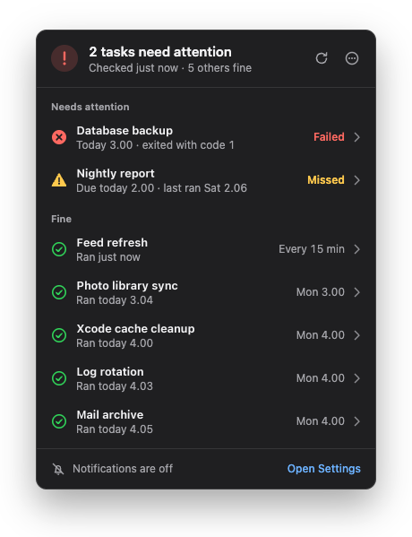
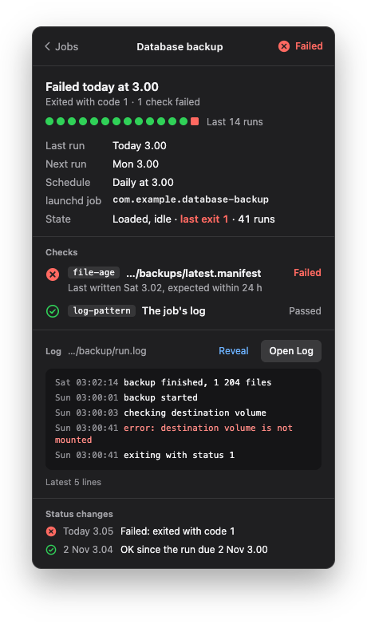

<h1 align="center">
  <picture>
    <source media="(prefers-color-scheme: dark)" srcset="docs/images/logo-dark.svg">
    
  </picture>
</h1>

<p align="center">
  
  
</p>

Aikana watches scheduled jobs (launchd on Macs, systemd timers and cron on Linux over SSH). You declare in a config file what is expected to run, where, when, and what counts as success. Aikana reports jobs that failed, jobs that never ran, and jobs that exited cleanly but did not produce their result.

## Status

Early. `aikana status` gives a verdict on each job: whether the run that was last due happened, failed or is missing, and whether it left behind what its checks ask for. The menu bar app shows the same verdicts, keeps them current and sends a notification when a job gets into trouble. Jobs can be on this Mac or on machines reached over SSH: launchd jobs on Macs, and jobs known only through their checks on Macs and Linux. systemd and cron jobs are listed and not read yet. The plan is in the issues, in three milestones: one Mac, other machines, release.

## Config

Aikana reads `~/.config/aikana/config.json5`. Another file can be named with `--config <path>` or the `AIKANA_CONFIG` environment variable. The format is JSON5, so comments and trailing commas are fine.

Start from [`Packages/AikanaCore/Examples/config.example.json5`](Packages/AikanaCore/Examples/config.example.json5), which shows every setting, then check your file:

```sh
cd Packages/AikanaCore
swift run aikana validate --config ~/.config/aikana/config.json5
```

`validate` lists every problem at once, each with where it is, and exits with 0 for a usable file, 1 for a file that breaks a rule and 66 for a file it cannot read. Settings it does not know, and settings written twice in the same object, are reported as errors, so a misspelled or repeated setting is not silently ignored.

## The app

The menu bar icon has three states: everything is fine, something needs attention (a run is missing, a job has been unreadable for a day, a machine cannot be reached, or the config or history file cannot be used), and a job failed.

The panel lists the jobs under "Needs attention", "Fine" and "Unknown", with headings only when there is more than one group. Each row says when the job last ran or was due, and on the right its state or when it runs next. With more than one machine, each row also names its machine. A job opens to its schedule, what its scheduler said, each check with its result, the verdicts it has been through, and the end of its log with a button that opens the file.

Aikana looks at every job once a minute, when the Mac wakes, and when you press refresh (⌘R in the list). It reads the config file again within a few seconds of a change. A config that cannot be used is shown with every problem in it, in place of the list; fix the file and the list comes back by itself. A history file that cannot be read or saved turns the icon to "needs attention" too.

### Notifications

Aikana sends a system notification when a job is found `failed`, `missed` or `stale`, naming the job, the machine and the reason. You hear about each incident once: nothing is repeated while the job stays in trouble, including when it waits for its next run and fails again. When the job is `ok` again you get one more notification, and after that a new problem is a new incident. A problem that turns into another kind, such as `missed` into `failed`, is told again.

Everything one look finds is combined into one notification. Clicking a notification about one job opens the panel on that job.

- A job with `notify: false` in the config is shown and never notifies.
- "Notifications" in the menu switches all of them off. A problem that starts while they are off is not brought up when you switch them on again; the job's recovery still is.
- "Notify When Fine Again" switches off the recovery notifications only.
- `host offline` and `unknown` never notify, whether or not the machine is marked `mayBeOffline`. An unreachable machine that should be on turns the icon to "needs attention".
- There is no daily summary.

The first look after installing tells, in one notification, every job that is already in trouble.

What you were last told about a job is kept in its record in the history file, so restarting Aikana does not repeat it. `aikana status` reads and writes the same history and never uses it up. The first time, macOS asks whether Aikana may show notifications; one that is due before you answer is not shown later.

The footer says whether notifications are on, with a button to turn them on, or to open System Settings when macOS blocks them. The `…` menu at the top right opens the config file (or shows where it should be when there is none), shows the history folder, holds the notification switches, and sets whether Aikana opens at login.

The app uses the same config and history files as `aikana status`, and honours `AIKANA_CONFIG` and `AIKANA_HISTORY`.

## Other machines

A host in the config names an alias from your own `~/.ssh/config`. Aikana runs the system `ssh` with that alias and stores no addresses, keys or passwords; whatever your SSH config and agent do for `ssh <alias>` in a terminal, they do here.

- **No questions are asked.** The connection must work without typing anything: a key in the agent or without a passphrase, and a host key that is already known. Connect once by hand first. A connection that would need a prompt counts as unreachable.
- **`host offline` is its own state.** A machine that cannot be connected to within 10 seconds, or does not answer the first question within another 15, is offline. Its jobs are neither judged nor checked, and the reason `ssh` gave is shown. It needs attention unless the host has `mayBeOffline: true`.
- **A machine that may be offline** is shown as offline without turning the icon. When it is back, scheduled times that passed while it was off or asleep are not held against its jobs, and for a job on an interval that time does not count. Nothing else is forgiven. A run that was already due when the machine was last seen is still expected. So is one whose time passed while the machine was awake and only out of reach: the job could run then, and the machine says whether it did.
- **A machine that should be on** gets no such allowance: if it was unreachable over a scheduled time and the run did not happen, the run is missed.
- **Times are the machine's own.** A job's schedule is read in the time zone of the machine it runs on. A machine whose clock differs from this Mac's by more than two minutes is not judged; its jobs are `unknown` and say so.
- **One connection per machine** is kept open for ten minutes after its last use, through a socket in `~/Library/Caches/Aikana/cm`, so a look does not connect once per job.
- **Machines are looked at side by side.** When a script that only reads gets no answer, for at most 25 seconds, the machine is given up on for that look: the rest of its jobs are `unknown` without further waiting. A `launchctl` or `command` check that takes too long is waited for by its own timeout and does not count against the machine. A look is finished when the slowest machine has answered or been given up on.
- **What the remote user's shell prints at login** (a banner, a line from a startup file) is ignored.

## What Aikana runs and reads

Aikana only reads. On this Mac it runs one command and reads one kind of file:

- `/bin/launchctl print gui/<your user id>/<label>` or `/bin/launchctl print system/<label>`, for each launchd job in your config. The label is refused unless it is one plain word.
- The plist files in `~/Library/LaunchAgents`, `/Library/LaunchAgents` and `/Library/LaunchDaemons`, to find each job's timetable and log paths, and the plist launchd says a job was loaded from.
- The modification time of each job's log files, and when this Mac last woke or started.
- For the checks you configure: the names, sizes and modification times of the files a `file-age` or `file-size` path matches (never their contents), and for a `log-pattern` check the part of the log the run wrote, plus the last 64 bytes of the log to recognise it by next time. Those bytes are kept in the history file.

- In the app, when you open a job: the last 16000 bytes of each of its log files, to show them. They are not kept.

Beyond that it runs only what you tell it to: the program of each `command` check, with the arguments as written and without a shell.

### On other machines

For a host reached over SSH, Aikana runs exactly this, with nothing from your config on the command line:

```sh
/usr/bin/ssh -T -o BatchMode=yes -o ConnectTimeout=10 -o ServerAliveInterval=5 -o ServerAliveCountMax=2 -o ControlMaster=auto -o ControlPath=<socket> -o ControlPersist=600 -- <alias> /bin/sh
```

The three `Control` options are left out when the path of your home folder is too long for a socket or has a space, `%`, quote or backslash in it; every script then makes its own connection.

What the remote `/bin/sh` does is a short script sent on its input. There are seven scripts, all in [`RemoteCommands.swift`](Packages/AikanaCore/Sources/AikanaCore/Remote/RemoteCommands.swift), and no others. Paths, patterns and arguments from your config appear in them only as single-quoted words, which a POSIX shell reads as plain text.

| Script | What it runs on the machine | Why |
|---|---|---|
| Probe | `uname -s`, `id -u`, `date +%s`, `sysctl -n kern.boottime`, `sysctl -n kern.waketime`, `readlink /etc/localtime`, and `printf` and `echo` to print `$HOME` and empty lines | What kind of machine it is, its clock, when it started and woke, its time zone. Sent first in every look. |
| Files by pattern | `cd` into the home folder for a `~/` path, the shell's own pattern matching, `[ -f ]`, `[ -d ]`, `[ -x ]`, `[ -r ]`, `/usr/bin/stat` | Name, size, modification time and identity of the files a `file-age` or `file-size` path matches. Never their contents. |
| One file | `[ -f ]`, `[ -e ]`, `[ -d ]`, `[ -x ]`, `[ -r ]`, `/usr/bin/stat` | The same for one path: a job's log file. |
| Read | `[ -e ]`, `[ -f ]`, `[ -r ]`, `tail -c`, `head -c` | The part of a log a run wrote, for a `log-pattern` check; the end of a log to show in the app; a launchd plist. |
| List plists | `[ -d ]`, `[ -r ]`, `[ -x ]`, `cd`, the shell's pattern matching, `[ -e ]` | The names of the `.plist` files in the three launchd folders, when a job's plist is not named after its label. |
| launchctl | `/bin/launchctl print gui/<user id>/<label>` or `system/<label>` | The state of a launchd job, as on this Mac. |
| Command check | `[ -x ]` and `[ -d ]` on the program, then the program of a `command` check with its arguments, reading nothing | Only what you wrote in the config. |

Every script also uses the shell's own `printf` to write its answer, and sets `LC_ALL=C` for itself. All of them only read, except a `command` check, which does whatever your program does.

```sh
cd Packages/AikanaCore
swift run aikana status --config ~/.config/aikana/config.json5
```

## How a job is judged

Each time Aikana looks at a job it asks one question: is there a scheduled time that no run accounts for? A run that is seen accounts for every scheduled time up to that moment. The verdict is about the oldest scheduled time still open, so a job that has stopped is reported once and stays reported until it runs again.

| Verdict | Meaning |
| --- | --- |
| `ok` | Every scheduled time so far is accounted for, and nothing about the last run failed. |
| `running` | The job is running now. |
| `waiting` | A run is due and still within its grace period, or no run has been due since Aikana started watching. |
| `failed` | The last run exited with an error or was killed, a check failed, or the job cannot run at all (not loaded, or not found). |
| `missed` | A run was due, its grace period is over, and there is no sign of it. It stays missed until a run is seen. |
| `unknown` | The job's state could not be read just now. This says nothing about the job. |
| `stale` | The state has been unreadable for a day. |
| `hostOffline` | The machine the job runs on cannot be reached. |

Things worth knowing:

- **Evidence of a run** is the scheduler's run count going up, the job's log file being written, or a check that proves it (a file newer than the scheduled time).
- **Grace** (`grace` in the config, 30 minutes by default) is how long after its scheduled time a run may still appear before it counts as missed.
- **Sleep.** launchd makes up for scheduled times that passed while the Mac slept with one run on wake. The grace period then counts from the wake, and that one run accounts for all of them, so a job is not reported as missed the moment the lid opens after a weekend.
- **Jobs on an interval** have no scheduled times. They are missed when the interval plus the grace has passed since the last run that was seen. Time asleep does not count.
- **A wake does not undo a miss.** Whether a scheduled time passed during sleep is settled when it is first found open. Waking the Mac later gives a run that was already missed no new grace period.
- **A run in progress counts.** launchd does not start a job that is still running, so a long run accounts for a scheduled time it runs through.
- **Nothing is judged in hindsight.** A run that was due before Aikana first saw the job, or before its timetable changed, is not called missed. Evidence that it did happen is still believed.
- **History** is kept in `~/Library/Application Support/Aikana/history.json` (or the file `AIKANA_HISTORY` names). launchd keeps no history of its own, so this file is what makes "the run count went up since last time" possible. A history file that cannot be read stops Aikana instead of being replaced.

### Checks

A job can exit with code 0 and still have produced nothing. Checks say what a successful run leaves behind.

| Check | Passes when |
| --- | --- |
| `file-age` | A file matching `path` is newer than the run's scheduled time, or newer than `maxAge` if that is given. |
| `file-size` | The newest file matching `path` is at least `minSize`. |
| `command` | The program in `run` exits with code 0 within `timeout`. |
| `log-pattern` | What the run wrote to the log contains `contains` and does not contain `notContains`. |

- **Three results.** A check passes, fails, or could not be carried out (a folder without permission, a command that hangs). The last makes the job `unknown`, never `failed`.
- **A check can prove a run.** A file newer than the scheduled time, or a wanted line in the log, shows the job ran even when the run itself was not seen.
- **A failing check does not fail a job whose run still has time.** Yesterday's report is expected to be old at 02:01.
- **Only what the run wrote.** A log only grows. Aikana notes where each log ends every time it looks, and reads from where the log stood before the run. A log it first sees after the run has already written to it is let through once and read properly from the next run on. A log that was emptied, rewritten or rotated is noticed and read from its start.
- **A run started by hand is judged on its own output.** If the scheduled run failed and you run the job again, the log check reads that run's lines and the commands are asked again.
- **Commands are not run at every look.** A `command` check runs once the job has run, and its result is kept for that run. It is asked again after 15 minutes, and at once when a new run is seen.
- **Paths** may contain `*`, `?` and `[...]`, and `~/` for the home directory. `**` is not supported.
- **Checks are skipped** while the job is running, and when the job cannot be looked at or cannot run.
- **`log-pattern` needs runs it can tell apart.** For a job on an interval, or one with no timetable, it reads the output of the latest run that was seen. A job with no source and an `every` schedule cannot have one; the config refuses it.

### Limits

- **A command check that hangs on another machine** is given up on after its timeout, but the program may keep running there. Aikana has no way to stop it that works on every system.
- **Paths on other machines:** a folder that cannot be read is told from "nothing there" only up to the first wildcard in a path. Behind a wildcard folder, such as `/data/*/out/x.log`, an unreadable folder looks empty.
- **File times on other machines** are read to the second.
- **Links on other machines** are not resolved when a job's plist is compared with the file launchd loaded it from; the file launchd names is then read once more.
- **A machine's time zone** is read from where `/etc/localtime` points. If that cannot be read, this Mac's zone is used.
- **A machine that may be offline and sleeps through a job's time every day** never has that job reported missed. That is what the setting means; leave it off for a machine whose jobs you want to hear about.
- **`stat` is run as `/usr/bin/stat`** on other machines. Where it is somewhere else, file checks cannot be carried out.
- **Linux:** checks work on a Linux host, but when it last started or woke is not read yet, and neither are systemd and cron. A Linux machine that may be offline is therefore taken to have been off for as long as it could not be reached.
- **A machine that may be offline, between two looks:** when Aikana itself was not looking, the machine is taken to have gone away right after the last look that found it.
- **A file or argument with a line break in it** cannot be used on another machine.
- **The app and `aikana status` at the same moment.** Both read the history, look, and write it back. If the two overlap, what the one that finishes first saw is overwritten. It is seen again at the next look.

- **Switched off at the scheduled time.** launchd does not make up for a time that passed while the Mac was off. Aikana reports that as missed once the grace after starting is over. It is true, even though nothing is wrong with the job.
- **Looking only now and then.** The run count has no timestamps. When Aikana has not looked for a while, it compares how many runs started with how many were scheduled. A run started by hand in that gap can then stand in for a scheduled one that did not happen, and a reload after an unseen run can hide it. With the app looking every minute this does not arise.
- **Log files** count as evidence when they are written. A log that something else also writes to makes a job look as if it ran.
- **A timetable with both calendar times and an interval** is judged by its calendar times only, and the interval's runs account for them.
- **A plist edited but not reloaded.** The timetable is read from the file, while launchd keeps the one from when it loaded the job.
- **Both a day of the month and a weekday** in one launchd calendar entry are read as "both must match".
- **After the time zone changes**, scheduled times from before the change are read in the new zone.
- **Paths in checks:** `*` does not match a name that starts with a dot, as in a shell. A `[` meant literally cannot be combined with a wildcard. A pattern that matches more than 10000 files is refused.
- **Long logs:** only the last megabyte of what a run wrote is read.
- **Shared logs:** lines another job writes to the same log count as this run's.
- **A log that is touched without being changed** looks rewritten, and is read from its start once.
- **`file-age` without `maxAge`** needs a scheduled time or an interval to compare with. On a job with no timetable it cannot be carried out; give it a `maxAge`.
- **A scheduler that reports no run count:** for a job on an interval, a new run is then recognised only by its checks, and the log is read from the first run on.

## Layout

```
Aikana/                  Menu bar app (SwiftUI, MenuBarExtra)
AikanaTests/             App tests
Packages/AikanaCore/     The engine, a Swift package
  Sources/AikanaCore/    Config, collectors, schedule logic, checks
  Sources/AikanaCLI/     The `aikana` command line tool
  Examples/               Example config
  Tests/AikanaCoreTests/ Engine tests
```

## Principles

- **Read-only.** Aikana never starts, stops or edits a job.
- **Nothing personal in the repo.** No real host names, paths or job names. Each user's setup is a config file kept elsewhere.
- **The engine stands alone.** `AikanaCore` uses Foundation only and does not depend on the app, so it can be published as its own package.
- **Not sandboxed.** The app needs `launchctl`, `ssh` and the user's SSH config. It is distributed directly, not through the Mac App Store.

## Build and test

Requires Xcode 27 and macOS 15.3 or later.

```sh
xcodebuild -scheme Aikana -destination 'platform=macOS' build
xcodebuild test -scheme Aikana -destination 'platform=macOS,arch=arm64'
```

The engine and the command line tool also build without Xcode's project:

```sh
cd Packages/AikanaCore
swift test
swift run aikana --version
```

## License

MIT. See [LICENSE](LICENSE).
